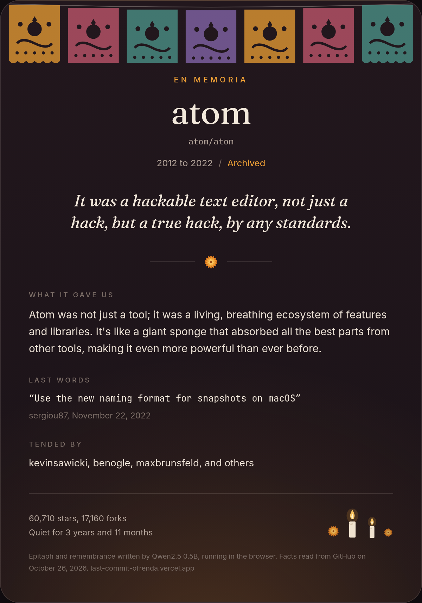

# Last Commit

An ofrenda for open source that went quiet.

Paste a public GitHub repository and Last Commit lays out a remembrance card for it: the years it was alive, what it gave people, its last words (the real final commit message) and the people who tended it. Then an open-weight model, running entirely in your browser tab, writes its epitaph.

Live: https://last-commit-ofrenda.vercel.app



Made for the DEV Hacktoberfest Open-Source AI Challenge, Week 4: Ghost in the Machine.

## How it works

1. **Facts first.** Your browser calls GitHub's public REST API with no token: the repository, its last ten commits, its top contributors, its README and its latest release. The card is built from those facts alone, so it is complete before any model loads.
2. **Last words.** The newest commit written by a person, skipping merges and version bumps.
3. **Then a model writes.** [Qwen2.5 Instruct](https://huggingface.co/Qwen) (0.5B or 1.5B, Apache 2.0) runs inside a Web Worker with [Transformers.js](https://github.com/huggingface/transformers.js). It uses WebGPU when your browser has it and WebAssembly on the CPU when it does not. It only sees a few lines of facts.
4. **Every reply is checked.** A reply is set aside, and the fact based line stays, if it invents a number that is not in the facts, slips into first person, includes links or emoji, echoes the prompt, or runs too long.
5. **Keep it.** Download the card as a PNG, share a `?repo=owner/name` link, fork the project or leave its maintainers a star.

The five examples (atom, brackets, angular.js, BrowserQuest, co) are bundled as snapshots read from GitHub on October 26, 2026, so they work even when the GitHub API rate limit (60 requests an hour per IP without a token) runs out. Refresh them with `GITHUB_TOKEN=... bun scripts/snapshot-examples.ts`.

## Privacy

There is no server and no account. The only network calls are to GitHub's public API and, the first time, to the Hugging Face Hub for the model weights, which your browser then caches. Nothing you look up is sent anywhere else.

## Models

| Model | WebGPU (q4f16) | CPU (q4) |
| --- | --- | --- |
| Qwen2.5 0.5B Instruct | about 480 MB | about 790 MB |
| Qwen2.5 1.5B Instruct | about 1.2 GB | about 1.8 GB |

The 1.5B model is the default on WebGPU and writes noticeably better lines. The 0.5B model is the default on CPU. You can swap with one click. The 8 bit CPU weights were tried and rejected, they produced garbled text.

## Develop

```bash
npm install
npm run dev
npm test          # parsing, status, fallback text and reply checks
npm run typecheck
npm run lint
npm run build
```

Next.js 16, React 19, TypeScript, Tailwind CSS 4, Vitest.

## Limitations

- Small models still write the odd flat or clumsy line. The checks catch invented facts, not dull prose.
- The first model download is large, and CPU generation is slow on older machines.
- Without a token, GitHub allows 60 API requests an hour per IP, and one lookup uses five.
- The status is a heuristic: archived, or no commits on the default branch for a year. A quiet repository is not always a dead one.

## AI disclosure

This project was built with help from an AI coding assistant. The words on each card are written in your browser by Qwen2.5 Instruct, or, if the model is not loaded or its reply fails the checks, assembled from the public facts.

## License

MIT. See [LICENSE](LICENSE).
